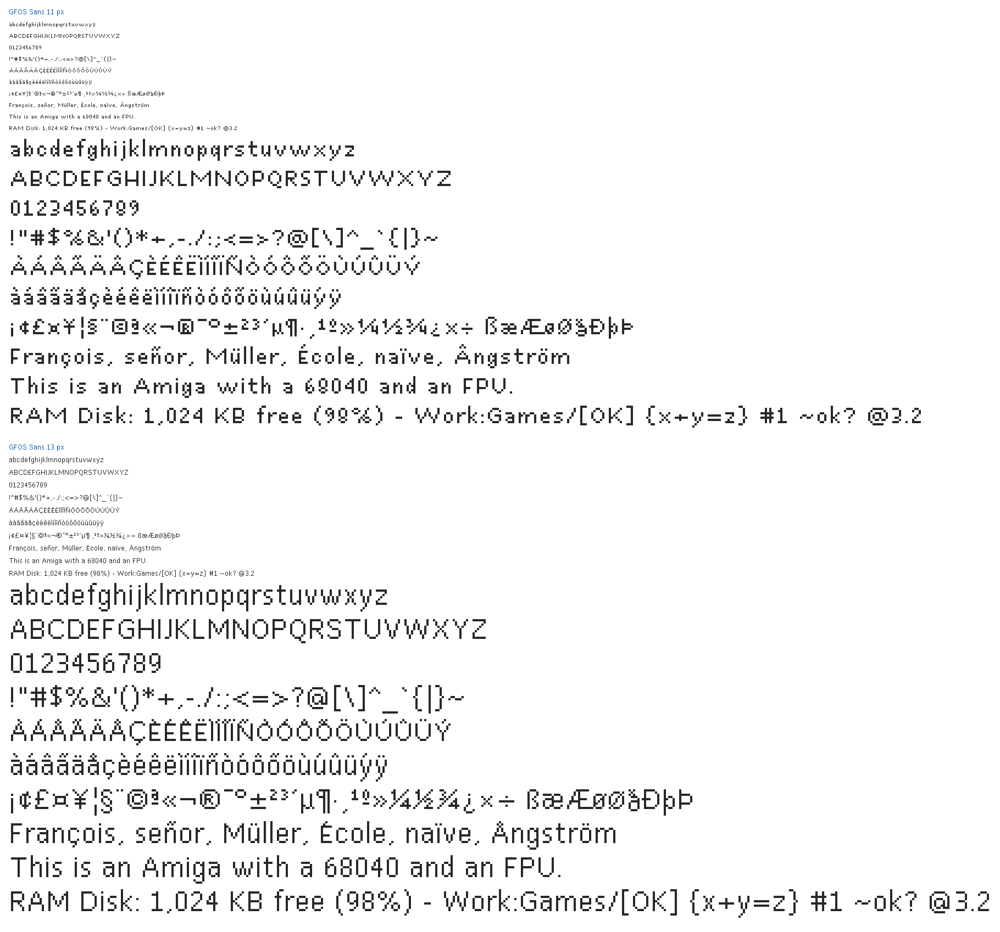
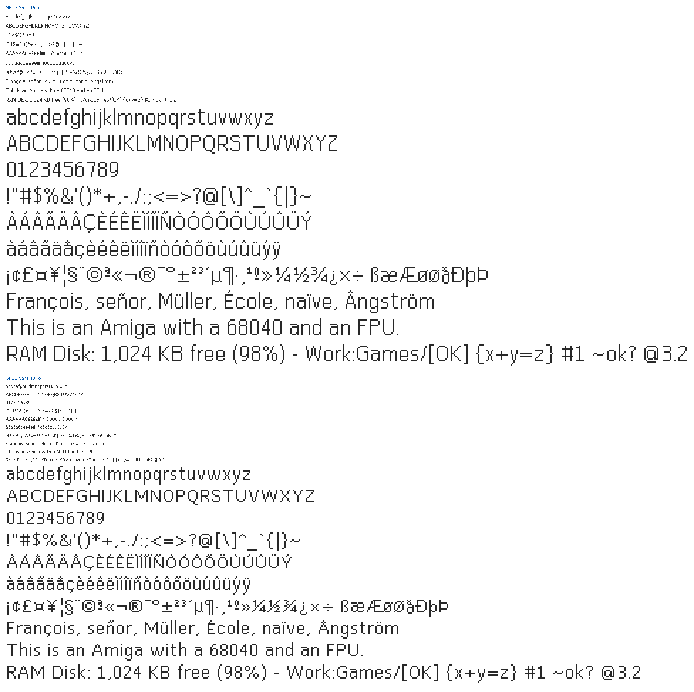
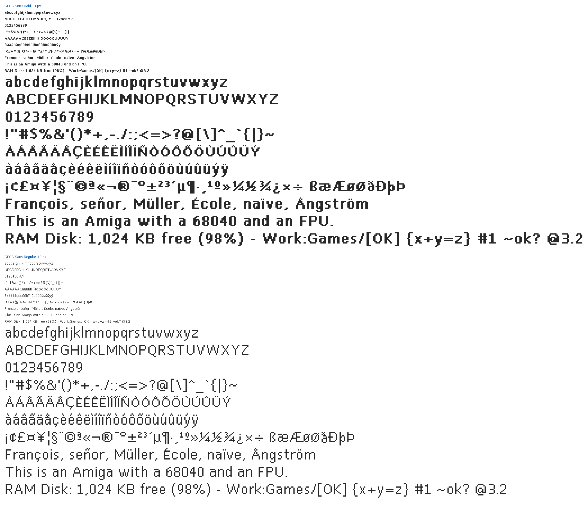
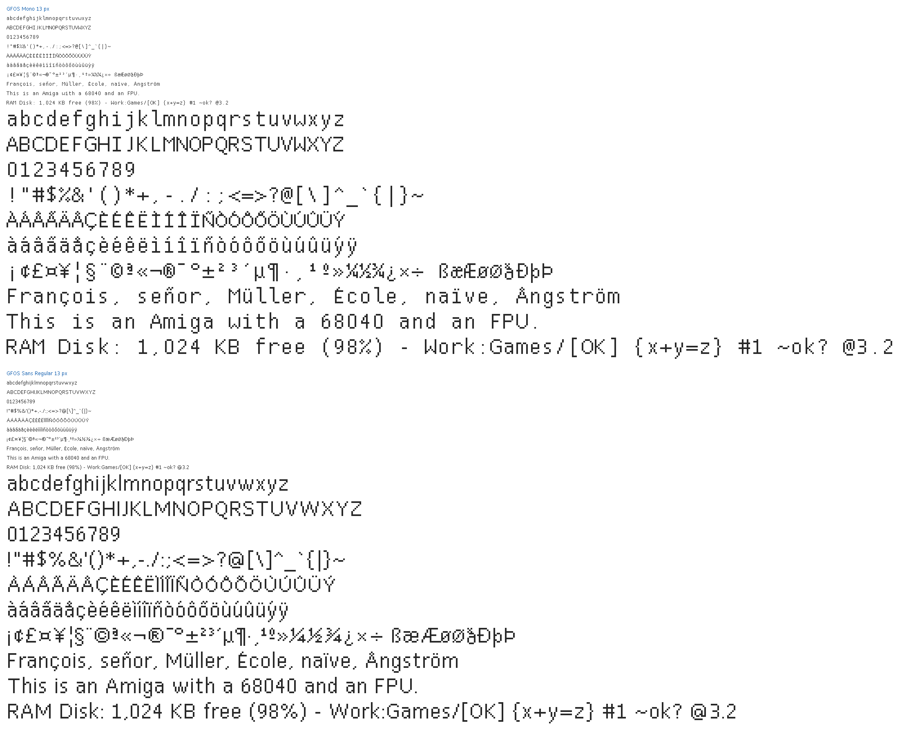

# GFOS Fonts

GFOS Sans and GFOS Mono: hand-corrected bitmap fonts for GFOS, derived from DejaVu.


GFOS's default fonts, drawn by hand pixel by pixel (Dale, 13 Nov 2026: "we should hand draw our
default fonts", "correcting these"). Decision: amicradle-teams `teams/DECISION-HANDDRAWN-FONTS-20261113-1954.md`.

Status: Dale approved the direction from the second sheet (14 Nov 04:36: "yes, go for it"). Third cut: Latin-1's accented letters, the letters with no plain base and most symbols. Nothing here is a default yet: Dale sees it on a real screen first.


## What is here
| File | What |
| --- | --- |
| `src/dejavu-sans-13-today.txt` | DejaVu Sans at 13 px exactly as GFOS draws it today (the `_ttf` font OpenBench uses), dumped by `tools/dump_grid` |
| `src/gfos-sans-13-hand.txt` | the characters drawn by hand: a-z, A-Z, 0-9, all the ASCII punctuation, and Latin-1's letters with no plain base and its symbols |
| `src/gfos-sans-13.txt` | GFOS Sans Regular 13 px: the hand set, and Latin-1's accented letters made from it (`compose`), over today's render (`gridfont.py merge`) |
| `src/gfos-sans-11-hand.txt` | GFOS Sans 11 px: the characters drawn by hand at 11 px (a e k z K S X Z, the figures 2 4 9, $ % & @ < >, and 21 Latin-1 symbols and letters with no plain base) |
| `src/gfos-sans-11.txt` | GFOS Sans Regular 11 px, ISO-Latin-1: the 11 px hand set, the accented letters made from its own letters (`compose`), the rest made from the 13 px face (`gridfont.py shrink`) |
| `src/gfos-sans-16-hand.txt` | GFOS Sans 16 px: the characters drawn by hand at 16 px (18 that grow can't make, and the figures 2 and 4) |
| `src/gfos-sans-16.txt` | GFOS Sans Regular 16 px, ISO-Latin-1: the 16 px hand set, the accented letters made from its own letters, the rest made from the 13 px face (`gridfont.py grow`) |
| `src/gfos-sans-bold-13-hand.txt` | GFOS Sans Bold 13 px: the characters drawn by hand (where doubling the stems fills a counter, and " ¨) |
| `src/gfos-sans-bold-13.txt` | GFOS Sans Bold 13 px, ISO-Latin-1: Regular 13 set again a pixel to the right (`gridfont.py bold`), the accented letters made from the bold letters |
| `src/gfos-sans-bold-11-hand.txt`, `src/gfos-sans-bold-16-hand.txt` | GFOS Sans Bold 11 and 16 px: the characters drawn by hand, by the same rule as 13 px |
| `src/gfos-sans-bold-11.txt`, `src/gfos-sans-bold-16.txt` | GFOS Sans Bold 11 and 16 px, ISO-Latin-1: Regular 11 and 16 set again a pixel to the right |
| `src/gfos-mono-13-hand.txt` | GFOS Mono 13 px: the characters drawn by hand (too wide for 8 columns, and the slabbed i j l I f r t) |
| `src/gfos-mono-13.txt` | GFOS Mono 13 px, ISO-Latin-1: every character 8 wide (`gridfont.py mono`) |
| `src/gfos-mono-11-hand.txt`, `src/gfos-mono-16-hand.txt` | GFOS Mono 11 and 16 px: the characters drawn by hand (too wide for 6 or 9 columns, and the slabs) |
| `src/gfos-mono-11.txt`, `src/gfos-mono-16.txt` | GFOS Mono 11 px (7 wide) and 16 px (10 wide), ISO-Latin-1 |
| `specimens/*.png` | the specimen sheets, actual size and at 4x: Sans 13 against today's DejaVu render and its Latin-1, Sans 11 and 16 against 13, Bold 13, Mono 13, and Bold and Mono at 11 and 16 |
| `tools/dump_grid.c` | dumps a TrueType face as GFOS draws it, as editable grids |
| `tools/gridfont.py` | reads, checks, merges and draws the grids |
| `tools/amigafont.py` | builds the Amiga bitmap font from a grid: `amigafont.py build src/gfos-sans-13.txt GFOSSans OUT src/gfos-sans-11.txt src/gfos-sans-16.txt` writes `OUT/GFOSSans.font` (every size) and `OUT/GFOSSans/11`, `13`, `16` for FONTS: (build outputs stay out of git) |

## The grid format
Plain text, one file per face and size, so every change is a readable diff:

```
size 13
ascent 10

char U+006E n
width 7
.......
...      13 rows of '.' (clear) and '#' (set), 'width' columns;
...      the baseline is under row 'ascent' (rows 0-9 above it, 10-12 below)
```

A glyph that starts left of its origin has an `origin N` line (N columns before the origin).
Lines starting `# ` are comments. The hand file is simpler: the character on its own line,
then its 13 rows; its width is the rows' length. `#`, which would read as a comment, is named
`char U+0023` instead.

## Today's render, reproduced
`dump_grid FONT.ttf 13` follows GFOS's own path (gfopenfont `library/textfont`): diskfont at 72 x 72 dpi
with no `OT_YSizeFactor` (FONTS:DejaVuSans.otag has none, so the em is 13 px), bullet's coverage set at
128 and over with no hinting, the advance rounded, a pixel added after a glyph with no room on its
right under 15 px to the em, and the descent kept whole. The DejaVu Sans used is 2.37 (759,720 bytes,
the same size as FONTS:_ttf/DejaVuSans.ttf on Instance-32).

## GFOS Sans 11 px
For the chipset profiles (1-3), once Dale approves it. 11 rows, ascent 9: row 0 clear for marks, ascenders
rows 1-8, capitals and figures rows 2-8 (7 px), x-height rows 4-8 (5 px), descenders rows 9-10, figures all 6
wide. `gridfont.py shrink` makes it from the 13 px face: above the x-height nothing changes, the x-height loses
two rows and the descent one, each time one of two like rows (a straight stem or a bowl's sides) nearest the
middle, and a glyph 7 or more wide loses one of two like inner columns. A glyph it can't make well is drawn in
`src/gfos-sans-11-hand.txt`, which wins. Latin-1's accented letters are made from the 11 px letters the
same way as at 13 px: a small letter's mark in rows 1-2, a capital lowered to rows 3-8 under its mark.



## GFOS Sans 16 px
For larger screens and anyone who picks it; 1080p and up stay 13 px (Dale, 14 Nov 02:43). 16 rows, ascent 13:
row 0 clear for marks, ascenders rows 1-12, capitals and figures rows 2-12 (11 px), x-height rows 5-12 (8 px),
descenders rows 13-15, figures all 8 wide. `gridfont.py grow` makes it from the 13 px face the other way round
from shrink: a row is only added beside a like row, nearest the middle, so stems stay 1 px (capitals gain two
rows, the x-height one, an ascender one above the x-height and one in it), and a glyph 6 or more wide gains a like
inner column. What it can't make is drawn in `src/gfos-sans-16-hand.txt`.



## GFOS Sans Bold 13 px
2 px stems: every glyph of Regular 13 set again one pixel to the right and one column wider, the way
graphics.library's BoldSmear draws a bold style, but drawn into the font once, so a bold label is the same width
everywhere and the counters can be kept open by hand. `gridfont.py bold` refuses a smeared glyph that loses a
counter (the inside of a, e, o, B, 8...): those are in `src/gfos-sans-bold-13-hand.txt`. The accented letters
are made from the bold letters with the regular marks, which stay open. The Amiga font is its own family,
`GFOSSansBold.font`, so a program that asks for it gets the drawn bold rather than a smeared regular.



## GFOS Mono 13 px
Every character 8 wide, for the shell, code and anything in columns. A GFOS Sans Regular 13 glyph whose ink is
7 columns or fewer is centred in columns 0-6, so column 7 is always the gap between characters (`gridfont.py
mono`); the wider ones (% & @ M W m w and others) and the narrow i j l I f r t, which get slabs to fill their cell,
are drawn in `src/gfos-mono-13-hand.txt`. The Amiga font `GFOSMono.font` is marked not proportional, tf_XSize 8.



## Rules for the hand-drawn set (from the decision)
- Stems 1 px at the small sizes, the same in every letter.
- Round shoulders on n, m, h, a and d: a one-pixel diagonal step, never a 2x2 blob.
- f and t never alike: f has a hook at the top and no foot, t a foot and no hook.
- x-height 7 px (rows 3-9); capitals and figures 9 px (rows 1-9); figures all 7 wide.

`gridfont.py check` finds 2 px stems and 2x2 blobs in the hand set. Today's DejaVu render
has problems in the same characters (233 in the first 63 alone); GFOS Sans has none in its hand-drawn and composed characters.

## Tests
`tests/run.sh` (467 + 31 checks; among them, every face and size built and its glyph strip checked under
65,536 px wide, since `tf_CharLoc`'s offsets are 16 bits, and `amigafont.py` refuses a wider one). With `GFOPENFONT=<gfopenfont checkout>` it also rebuilds `dump_grid`
and checks that today's render is unchanged.

## Next (Dale, 14 Nov 04:36: finish Latin-1, then the other sizes, Bold and Mono)
Done: Latin-1 ($80-$9F left empty); GFOS Sans, Sans Bold and Mono at 11, 13 and 16 px (Mono 7, 8 and 10 wide);
the build to Amiga diskfont `.font` files (`tools/amigafont.py`), which gfopenup's GFOSFonts part installs in
FONTS:. Still open from the list: GFOS Mono 8x16 and 10x20 as first planned, and hires (1:2) cuts.

## Licences
- **The fonts** (GFOS Sans, GFOS Mono and anything else derived from DejaVu here) are under the Bitstream Vera licence, with DejaVu's changes in the public domain. See `LICENSE-FONTS`. That licence lets the glyphs be changed only if the changed fonts are renamed, so no font in this repository may have "Bitstream" or "Vera" in its name.
- **The tools** in this repository (converters, build and check scripts) are MIT. See `LICENSE-TOOLS`.

Designed, tested and delivered by The AmiCradle Team.
