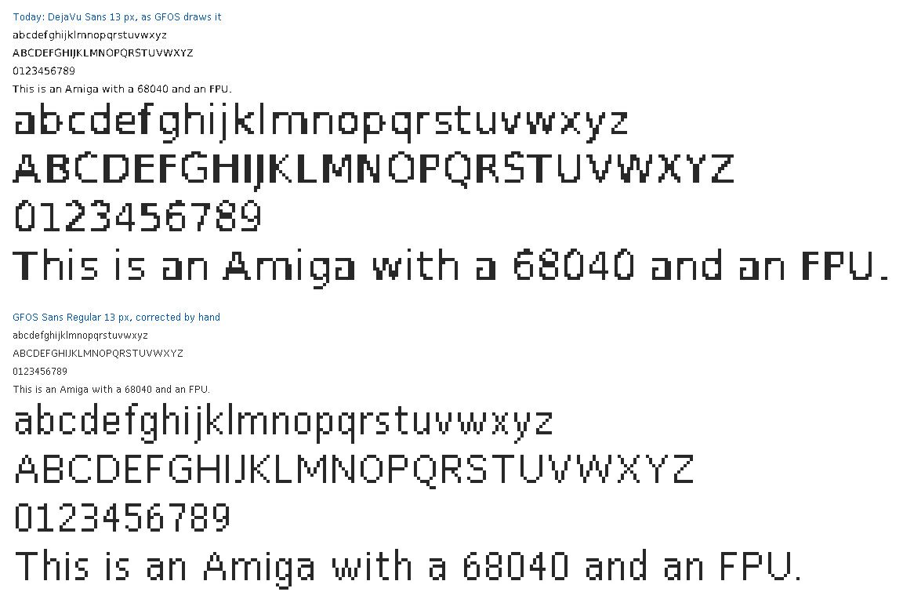

# gfosfonts

GFOS's default fonts, drawn by hand pixel by pixel (Dale, 13 Nov 2026: "we should hand draw our
default fonts", "correcting these"). Decision: amicradle-teams `teams/DECISION-HANDDRAWN-FONTS-20261113-1954.md`.

Status: **specimen sheet only, for Dale to judge** (second cut, 14 Nov: the ASCII punctuation added). Nothing here is a default yet.



## What is here
| File | What |
| --- | --- |
| `src/dejavu-sans-13-today.txt` | DejaVu Sans at 13 px exactly as GFOS draws it today (the `_ttf` font OpenBench uses), dumped by `tools/dump_grid` |
| `src/gfos-sans-13-hand.txt` | the characters corrected by hand so far: a-z, A-Z, 0-9 and all the ASCII punctuation |
| `src/gfos-sans-13.txt` | GFOS Sans Regular 13 px: the hand set, and Latin-1's accented letters made from it (`compose`), over today's render (`gridfont.py merge`) |
| `specimens/gfos-sans-13-vs-dejavu.png` | the specimen sheet: both faces, actual size and at 4x |
| `tools/dump_grid.c` | dumps a TrueType face as GFOS draws it, as editable grids |
| `tools/gridfont.py` | reads, checks, merges and draws the grids |

## The grid format
Plain text, one file per face and size, so every change is a readable diff:

```
size 13
ascent 10

char U+006E n
width 7
.......
...      13 rows of '.' (clear) and '#' (set), 'width' columns;
...      the baseline is under row 'ascent' (rows 0-9 above it, 10-12 below)
```

A glyph that starts left of its origin has an `origin N` line (N columns before the origin).
Lines starting `# ` are comments. The hand file is simpler: the character on its own line,
then its 13 rows; its width is the rows' length. `#`, which would read as a comment, is named
`char U+0023` instead.

## Today's render, reproduced
`dump_grid FONT.ttf 13` follows GFOS's own path (gfopenfont `library/textfont`): diskfont at 72 x 72 dpi
with no `OT_YSizeFactor` (FONTS:DejaVuSans.otag has none, so the em is 13 px), bullet's coverage set at
128 and over with no hinting, the advance rounded, a pixel added after a glyph with no room on its
right under 15 px to the em, and the descent kept whole. The DejaVu Sans used is 2.37 (759,720 bytes,
the same size as FONTS:_ttf/DejaVuSans.ttf on Instance-32).

## Rules for the hand-drawn set (from the decision)
- Stems 1 px at the small sizes, the same in every letter.
- Round shoulders on n, m, h, a and d: a one-pixel diagonal step, never a 2x2 blob.
- f and t never alike: f has a hook at the top and no foot, t a foot and no hook.
- x-height 7 px (rows 3-9); capitals and figures 9 px (rows 1-9); figures all 7 wide.

`gridfont.py check` finds 2 px stems and 2x2 blobs in the hand set. Today's DejaVu render
has problems in the same characters (233 in the first 63 alone); GFOS Sans has none in its 94.

## Tests
`tests/run.sh` (71 checks). With `GFOPENFONT=<gfopenfont checkout>` it also rebuilds `dump_grid`
and checks that today's render is unchanged.

## Next (after Dale's verdict on this sheet)
The rest of ISO-Latin-1 ($A0-$FF; $80-$9F left empty), Bold, 11 and 16 px, GFOS Mono 8x16 and 10x20,
hires (1:2) cuts, then the build to Amiga diskfont `.font` files.

## Licences
Tools and documents: MIT (`LICENSE`). The fonts start from DejaVu Sans, whose changes are public
domain over Bitstream Vera; the Vera licence is in `LICENSE-VERA.txt`. As it asks, the changed fonts
have their own names (GFOS Sans, GFOS Mono) and use neither "Bitstream" nor "Vera".

Designed, tested and delivered by The AmiCradle Team.
